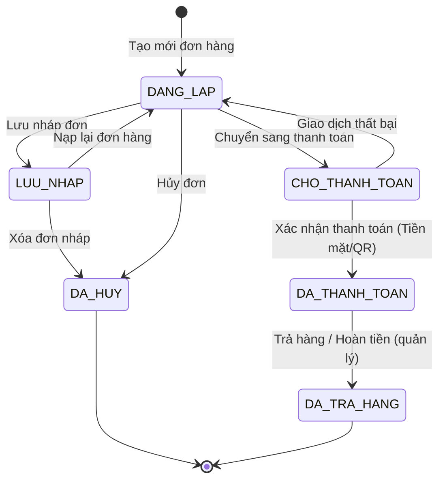
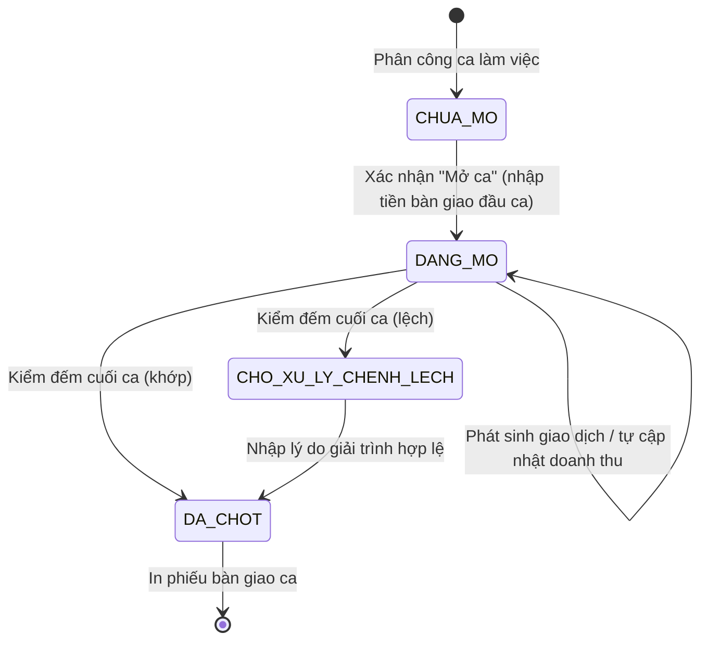

# Souvenir POS – Hệ thống bán hàng cửa hàng quà lưu niệm
 
Đồ án môn **Phân tích & Thiết kế Hướng đối tượng (OOAD)**.
Hệ thống POS hỗ trợ thu ngân quét mã vạch, lập đơn, thanh toán (tiền mặt / QR), quản lý ca làm việc, nhập kho, kiểm kê, trả hàng và tích điểm khách hàng.
 
| Thành phần | Công nghệ |
|---|---|
| Backend | C#, .NET 8+ (ASP.NET Core Web API), EF Core, kiến trúc phân lớp (Clean Architecture) |
| Database | PostgreSQL 16 chạy trên Docker |
| Frontend | React + TypeScript (Vite), React Router, Axios, Zod |
 
---
 
## 1. Mục lục
 
1. [Cấu trúc thư mục đầy đủ](#2-cấu-trúc-thư-mục-đầy-đủ)
2. [Các file cần tạo theo từng lớp](#3-các-file-cần-tạo-theo-từng-lớp)
3. [Cơ sở dữ liệu (ERD)](#4-cơ-sở-dữ-liệu-erd)
4. [Sơ đồ trạng thái](#5-sơ-đồ-trạng-thái)
5. [Danh sách API gợi ý](#6-danh-sách-api-gợi-ý)
6. [Cài đặt & chạy dự án](#7-cài-đặt--chạy-dự-án)
7. [Tài liệu liên quan cần biết](#8-tài-liệu-liên-quan-cần-biết)
8. [Tài liệu OOAD cần nộp (checklist)](#9-tài-liệu-ooad-cần-nộp-checklist)
9. [Quy ước làm việc](#10-quy-ước-làm-việc)
---
 
## 2. Cấu trúc thư mục đầy đủ
 
> Thư mục hiện có: `backend/src/{Souvenir.Api, Souvenir.Application, Souvenir.Domain, Souvenir.Infrastructure}` và `frontend/`.
> Các mục đánh dấu `(mới)` là file/thư mục cần tạo thêm.
 
```text
souvenir-pos/
├── README.md                          (mới)
├── docker-compose.yml                 (mới)  PostgreSQL (+ pgAdmin tuỳ chọn)
├── .env.example                       (mới)  mẫu biến môi trường
├── .gitignore                         (mới)
├── docs/                              (mới)  tài liệu OOAD
│   ├── Do_an_OOAD.docx                       sơ đồ trạng thái + ERD
│   ├── usecase/                              use case diagram + đặc tả
│   ├── class-diagram/                        sơ đồ lớp (domain + design)
│   ├── sequence/                             sơ đồ tuần tự
│   ├── state/                                sơ đồ trạng thái (Đơn hàng, Ca làm việc)
│   └── erd/                                  ERD
│
├── database/                          (mới)
│   └── init/
│       └── 01_init.sql                       tạo bảng + dữ liệu mẫu (Docker tự chạy)
│
├── backend/
│   ├── Souvenir.sln                   (mới)
│   └── src/
│       ├── Souvenir.Domain/                  ← lớp lõi, KHÔNG phụ thuộc lớp nào
│       │   ├── Entities/                (mới)
│       │   ├── Enums/                   (mới)
│       │   ├── Exceptions/              (mới)
│       │   ├── Interfaces/              (mới)
│       │   └── Souvenir.Domain.csproj
│       │
│       ├── Souvenir.Application/             ← use case / nghiệp vụ, phụ thuộc Domain
│       │   ├── Common/                  (mới)  Result, PagedResult, Interfaces dùng chung
│       │   ├── DTOs/                    (mới)
│       │   ├── Interfaces/              (mới)  IOrderService, IShiftService, ...
│       │   ├── Services/                (mới)
│       │   ├── Validators/              (mới)
│       │   ├── Mappings/                (mới)
│       │   └── Souvenir.Application.csproj
│       │
│       ├── Souvenir.Infrastructure/          ← EF Core, repository, JWT; phụ thuộc Application + Domain
│       │   ├── Persistence/             (mới)
│       │   │   ├── AppDbContext.cs
│       │   │   ├── Configurations/              Fluent API cho từng entity
│       │   │   ├── Migrations/
│       │   │   └── DbSeeder.cs
│       │   ├── Repositories/            (mới)
│       │   ├── Security/                (mới)  JwtTokenService, PasswordHasher
│       │   ├── DependencyInjection.cs   (mới)
│       │   └── Souvenir.Infrastructure.csproj
│       │
│       └── Souvenir.Api/                     ← lớp trình bày, phụ thuộc Application + Infrastructure
│           ├── Controllers/
│           │   ├── AuthController.cs        (mới)
│           │   ├── ProductsController.cs    (mới)
│           │   ├── OrdersController.cs      (mới)
│           │   ├── ShiftsController.cs      (mới)
│           │   ├── CustomersController.cs   (mới)
│           │   ├── VouchersController.cs    (mới)
│           │   ├── SuppliersController.cs   (mới)
│           │   ├── StockInController.cs     (mới)
│           │   ├── StocktakeController.cs   (mới)
│           │   ├── ReturnsController.cs     (mới)
│           │   └── ReportsController.cs     (mới)
│           ├── Middlewares/             (mới)  ExceptionHandlingMiddleware
│           ├── Properties/launchSettings.json
│           ├── appsettings.json
│           ├── appsettings.Development.json    (mới)
│           ├── Program.cs
│           └── Souvenir.Api.csproj
│
└── frontend/
    ├── package.json
    ├── tsconfig.json
    ├── vite.config.ts
    ├── eslint.config.js
    ├── .env.example                     (mới)  VITE_API_URL=http://localhost:5000/api
    ├── index.html
    ├── public/
    └── src/
        ├── main.tsx
        ├── App.tsx
        ├── assets/
        ├── api/                         (mới)  axiosClient.ts + 1 file / module (orderApi.ts, ...)
        ├── types/                       (mới)  interface/type dùng chung (Order, Product, Shift...)
        ├── schemas/                     (mới)  Zod schema validate form
        ├── hooks/                       (mới)  useAuth, useCart, useShift, ...
        ├── context/                     (mới)  AuthContext, ShiftContext
        ├── routes/                      (mới)  AppRoutes.tsx, ProtectedRoute.tsx
        ├── layouts/                     (mới)  MainLayout, PosLayout
        ├── components/                  (mới)  component dùng lại: Button, Modal, Table, ...
        ├── pages/                       (mới)
        │   ├── Login/
        │   ├── Pos/                            màn hình thu ngân (quét mã, giỏ hàng, thanh toán)
        │   ├── Shifts/                         mở ca / chốt ca / bàn giao
        │   ├── Products/
        │   ├── StockIn/
        │   ├── Stocktake/
        │   ├── Returns/
        │   ├── Customers/
        │   ├── Vouchers/
        │   └── Reports/
        └── utils/                       (mới)  formatCurrency, formatDate, ...
```
 
> **Không commit**: `node_modules/`, `bin/`, `obj/`, `.env`, `.vs/`. Xem mục [Quy ước làm việc](#10-quy-ước-làm-việc).
 
---
 
## 3. Các file cần tạo theo từng lớp
 
### 3.1. `Souvenir.Domain` (lõi nghiệp vụ)
 
**Entities** (khớp với ERD – xem mục 4):
 
| File | Ghi chú nghiệp vụ |
|---|---|
| `NguoiDung.cs` | Vai trò: Quản lý / Nhân viên / Thủ kho |
| `SanPham.cs` | Có phương thức trừ/cộng tồn kho, kiểm tra đủ hàng |
| `KhachHang.cs` | Cộng điểm tích lũy sau mỗi đơn thanh toán |
| `MaGiamGia.cs` | Kiểm tra còn hiệu lực theo ngày |
| `CaLamViec.cs` | Chứa **state machine** ca làm việc (mở ca, chốt ca, giải trình chênh lệch) |
| `ChamCong.cs` | Check-in / check-out |
| `DonHang.cs` | Aggregate root, chứa **state machine** đơn hàng + danh sách `ChiTietDonHang` |
| `ChiTietDonHang.cs` | Dòng sản phẩm của đơn |
| `PhieuTraHang.cs`, `ChiTietTraHang.cs` | Trả hàng / hoàn tiền (do quản lý xác nhận) |
| `NhaCungCap.cs` | |
| `PhieuNhapKho.cs`, `ChiTietNhapKho.cs` | Nhập kho → cộng tồn |
| `PhieuKiemKe.cs`, `ChiTietKiemKe.cs` | Kiểm kê → ghi nhận chênh lệch |
 
**Enums**: `VaiTro`, `TrangThaiNguoiDung`, `TrangThaiDonHang`, `TrangThaiCaLamViec`, `HinhThucThanhToan`, `TrangThaiKiemKe`.
 
**Exceptions**: `DomainException`, `InvalidStateTransitionException`, `InsufficientStockException`.
 
**Interfaces**: `IRepository<T>`, `IDonHangRepository`, `ISanPhamRepository`, `ICaLamViecRepository`, `IUnitOfWork`.
 
### 3.2. `Souvenir.Application`
 
- **DTOs**: `LoginRequest/Response`, `ProductDto`, `CreateOrderRequest`, `OrderDto`, `AddOrderItemRequest`, `PayOrderRequest`, `OpenShiftRequest`, `CloseShiftRequest`, `ReturnRequest`, `StockInRequest`, `StocktakeRequest`, ...
- **Services**: `AuthService`, `ProductService`, `OrderService`, `ShiftService`, `CustomerService`, `VoucherService`, `StockInService`, `StocktakeService`, `ReturnService`, `ReportService`.
- **Validators** (FluentValidation): mỗi request chính một validator.
- **Mappings**: AutoMapper profile hoặc mapping thủ công.
### 3.3. `Souvenir.Infrastructure`
 
- `AppDbContext` + `IEntityTypeConfiguration<T>` cho từng entity (map sang bảng snake_case trong PostgreSQL).
- Repository triển khai các interface ở Domain.
- `JwtTokenService`, `PasswordHasher` (BCrypt).
- `DbSeeder` để tạo hash mật khẩu thật cho tài khoản mẫu.
- `DependencyInjection.cs` với extension `AddInfrastructure(IConfiguration)`.
### 3.4. `Souvenir.Api`
 
- Controller mỏng: nhận request → gọi Service → trả response.
- `Program.cs`: đăng ký DI, JWT, CORS cho `http://localhost:5173`, Swagger.
- `ExceptionHandlingMiddleware`: chuyển `DomainException` thành HTTP 400/409 thống nhất.
### 3.5. Quy tắc phụ thuộc giữa các project
 
```text
Api ──────► Application ──────► Domain
 │                                ▲
 └────► Infrastructure ───────────┘   (Infrastructure cũng tham chiếu Application)
```
 
Lệnh thêm tham chiếu:
 
```bash
cd backend
dotnet new sln -n Souvenir
dotnet sln add src/Souvenir.Domain src/Souvenir.Application src/Souvenir.Infrastructure src/Souvenir.Api
 
dotnet add src/Souvenir.Application    reference src/Souvenir.Domain
dotnet add src/Souvenir.Infrastructure reference src/Souvenir.Application src/Souvenir.Domain
dotnet add src/Souvenir.Api            reference src/Souvenir.Application src/Souvenir.Infrastructure
```
 
NuGet package gợi ý:
 
```bash
# Infrastructure
dotnet add src/Souvenir.Infrastructure package Microsoft.EntityFrameworkCore
dotnet add src/Souvenir.Infrastructure package Npgsql.EntityFrameworkCore.PostgreSQL
dotnet add src/Souvenir.Infrastructure package Microsoft.EntityFrameworkCore.Design
dotnet add src/Souvenir.Infrastructure package BCrypt.Net-Next
 
# Application
dotnet add src/Souvenir.Application package FluentValidation
 
# Api
dotnet add src/Souvenir.Api package Microsoft.AspNetCore.Authentication.JwtBearer
dotnet add src/Souvenir.Api package Swashbuckle.AspNetCore
dotnet add src/Souvenir.Api package Microsoft.EntityFrameworkCore.Design
```
 
Frontend (đã có `react-router-dom`, `axios`, `zod`), nên thêm:
 
```bash
cd frontend
npm i react-hook-form @hookform/resolvers @tanstack/react-query
```
 
---
 
## 4. Cơ sở dữ liệu (ERD)
 
Script khởi tạo: [`database/init/01_init.sql`](database/init/01_init.sql) – gồm **15 bảng**:
 
| Nhóm | Bảng |
|---|---|
| Người dùng & ca | `nguoi_dung`, `ca_lam_viec`, `cham_cong` |
| Danh mục | `san_pham`, `khach_hang`, `ma_giam_gia`, `nha_cung_cap` |
| Bán hàng | `don_hang`, `chi_tiet_don_hang` |
| Trả hàng | `phieu_tra_hang`, `chi_tiet_tra_hang` |
| Kho | `phieu_nhap_kho`, `chi_tiet_nhap_kho`, `phieu_kiem_ke`, `chi_tiet_kiem_ke` |
 
Quan hệ chính (theo ERD):
 
- `nguoi_dung` 1–N `ca_lam_viec`, `don_hang`, `phieu_nhap_kho`, `phieu_kiem_ke`, `phieu_tra_hang`, `cham_cong`
- `ca_lam_viec` 1–N `don_hang` (chốt đơn), 1–N `cham_cong` (ghi nhận)
- `khach_hang` 1–N `don_hang`; `ma_giam_gia` 1–N `don_hang`
- `don_hang` 1–N `chi_tiet_don_hang`; `don_hang` 1–N `phieu_tra_hang`
- `san_pham` liên kết với các bảng chi tiết (đơn hàng, nhập kho, kiểm kê, trả hàng)
**Điểm khác/bổ sung so với ERD trong file docx** (cần cập nhật lại ERD cho khớp):
 
1. Thêm cột `don_hang.trang_thai` và `ca_lam_viec.trang_thai` để cài đặt hai sơ đồ trạng thái.
2. Thêm `ca_lam_viec.ly_do_chenh_lech` cho bước "Nhập lý do giải trình hợp lệ".
3. `chi_tiet_*.thanh_tien` và `chi_tiet_kiem_ke.so_luong_chenh_lech` là **cột tính tự động** (generated column).
4. `phieu_kiem_ke.trang_thai` dùng giá trị `DANG_KIEM / HOAN_TAT / HUY` (ERD chưa nêu giá trị cụ thể – đổi nếu nhóm đã chốt khác).
5. Thêm ràng buộc: mỗi nhân viên chỉ có **một ca đang mở** tại một thời điểm.
6. `nguoi_dung.mat_khau` chứa **hash**; dữ liệu mẫu đang là placeholder `CHANGE_ME_BCRYPT_HASH`.
---
 
## 5. Sơ đồ trạng thái
 
### 5.1. Đơn hàng
 

 
| Trạng thái | Ý nghĩa | Hệ quả khi vào trạng thái |
|---|---|---|
| `DANG_LAP` | Đang quét mã, thêm sản phẩm, áp mã giảm giá | — |
| `LUU_NHAP` | Khách đi lựa thêm đồ | Lưu tạm, có thể nạp lại |
| `CHO_THANH_TOAN` | Đã chốt danh sách và tổng tiền | Chờ quét QR / nhập tiền mặt |
| `DA_THANH_TOAN` | Giao dịch hoàn tất | **Trừ tồn kho**, in hóa đơn, cộng doanh thu ca, cộng điểm tích lũy |
| `DA_HUY` | Khách đổi ý / xóa đơn nháp | Không ghi nhận doanh thu |
| `DA_TRA_HANG` | Khách hoàn trả sau khi mua | Quản lý xác nhận hoàn tiền, **cộng lại tồn kho** (tùy tình trạng hàng) |
 
### 5.2. Ca làm việc
 

 
Quy tắc cài đặt: chỉ được bán hàng khi ca ở `DANG_MO`; ca `DA_CHOT` bị **khóa số liệu**.
 
> **Gợi ý OOAD (State pattern):** nên cài đặt mỗi trạng thái thành một lớp (`IOrderState`, `DangLapState`, ...) hoặc đặt phương thức chuyển trạng thái ngay trong entity (`DonHang.ChuyenSangThanhToan()`) và ném `InvalidStateTransitionException` khi chuyển sai luật – tránh `if/else` rải rác ở Service.
 
---
 
## 6. Danh sách API gợi ý
 
Tiền tố: `/api`. Xác thực JWT (trừ `/auth/login`), phân quyền theo vai trò.
 
| Nhóm | Method & Endpoint | Mô tả | Vai trò |
|---|---|---|---|
| Auth | `POST /auth/login` | Đăng nhập, trả JWT | Tất cả |
| Ca | `POST /shifts/open` | Mở ca (nhập tiền đầu ca) | Nhân viên |
| Ca | `POST /shifts/{id}/close` | Kiểm đếm, chốt ca | Nhân viên |
| Ca | `POST /shifts/{id}/explain` | Nhập lý do chênh lệch | Nhân viên/Quản lý |
| Ca | `GET /shifts/{id}/handover` | Phiếu bàn giao ca | Nhân viên/Quản lý |
| Sản phẩm | `GET /products?barcode=&keyword=` | Tìm / quét mã | Tất cả |
| Sản phẩm | `POST/PUT/DELETE /products` | Quản lý sản phẩm | Quản lý |
| Đơn hàng | `POST /orders` | Tạo đơn mới | Nhân viên |
| Đơn hàng | `POST /orders/{id}/items` | Thêm/sửa/xóa sản phẩm | Nhân viên |
| Đơn hàng | `POST /orders/{id}/voucher` | Áp mã giảm giá | Nhân viên |
| Đơn hàng | `POST /orders/{id}/draft` · `/resume` | Lưu nháp / nạp lại | Nhân viên |
| Đơn hàng | `POST /orders/{id}/checkout` | Chuyển sang chờ thanh toán | Nhân viên |
| Đơn hàng | `POST /orders/{id}/pay` | Xác nhận thanh toán (tiền mặt/QR) | Nhân viên |
| Đơn hàng | `POST /orders/{id}/cancel` | Hủy đơn | Nhân viên |
| Trả hàng | `POST /returns` | Lập phiếu trả / hoàn tiền | Quản lý |
| Khách hàng | `GET/POST /customers` | Tra cứu theo SĐT, tạo mới | Nhân viên |
| Voucher | `GET/POST/PUT /vouchers` | Quản lý mã giảm giá | Quản lý |
| Nhà cung cấp | `GET/POST/PUT /suppliers` | | Quản lý/Thủ kho |
| Nhập kho | `POST /stock-in` | Lập phiếu nhập | Thủ kho |
| Kiểm kê | `POST /stocktakes` · `POST /stocktakes/{id}/complete` | Kiểm kê & ghi nhận chênh lệch | Thủ kho |
| Chấm công | `POST /attendance/check-in` · `/check-out` | | Nhân viên |
| Báo cáo | `GET /reports/revenue`, `/reports/stock` | Doanh thu, tồn kho | Quản lý |
 
---
 
## 7. Cài đặt & chạy dự án
 
### 7.1. Yêu cầu
 
- [.NET SDK 8+](https://dotnet.microsoft.com/download)
- [Node.js LTS](https://nodejs.org/) (kèm npm)
- [Docker Desktop](https://www.docker.com/products/docker-desktop/)
- (Tuỳ chọn) `dotnet-ef`: `dotnet tool install --global dotnet-ef`
### 7.2. Database (PostgreSQL trên Docker)
 
```bash
# từ thư mục gốc souvenir-pos/
cp .env.example .env          # Windows PowerShell: copy .env.example .env
docker compose up -d          # chạy PostgreSQL, tự chạy database/init/01_init.sql lần đầu
docker compose ps             # kiểm tra container "healthy"
 
# (tuỳ chọn) bật pgAdmin tại http://localhost:5050
docker compose --profile tools up -d
```
 
Kiểm tra bảng đã được tạo:
 
```bash
docker exec -it souvenir-postgres psql -U souvenir -d souvenir_db -c "\dt"
```
 
**Chạy lại script từ đầu** (xóa sạch dữ liệu!):
 
```bash
docker compose down -v        # -v xóa volume; init script chỉ chạy khi volume còn trống
docker compose up -d
```
 
Chuỗi kết nối cho backend:
 
```text
Host=localhost;Port=5432;Database=souvenir_db;Username=souvenir;Password=souvenir_pass
```
 
### 7.3. Backend
 
Trong `Souvenir.Api/appsettings.Development.json`:
 
```json
{
  "ConnectionStrings": {
    "Default": "Host=localhost;Port=5432;Database=souvenir_db;Username=souvenir;Password=souvenir_pass"
  },
  "Jwt": {
    "Key": "DOI_THANH_CHUOI_BI_MAT_DAI_IT_NHAT_32_KY_TU",
    "Issuer": "Souvenir.Api",
    "Audience": "Souvenir.Client",
    "ExpireMinutes": 480
  },
  "Cors": { "AllowedOrigins": [ "http://localhost:5173" ] }
}
```
 
```bash
cd backend
dotnet restore
dotnet build
dotnet run --project src/Souvenir.Api
# Swagger: http://localhost:<port>/swagger
```
 
**Hướng làm việc với DB** – chọn một trong hai (đừng dùng đồng thời kẻo lệch schema):
 
- **A. Database-first (khuyên dùng nếu giữ `01_init.sql`)**: schema do SQL quản lý; EF chỉ map.
```bash
dotnet ef dbcontext scaffold "Host=localhost;Database=souvenir_db;Username=souvenir;Password=souvenir_pass" \
  Npgsql.EntityFrameworkCore.PostgreSQL --project src/Souvenir.Infrastructure \
  --startup-project src/Souvenir.Api --output-dir Persistence/Scaffolded
```
  Sau đó chuyển entity về `Souvenir.Domain` và viết lại thành rich domain model.
- **B. Code-first**: viết entity + Fluent API, dùng `dotnet ef migrations add Init` rồi `dotnet ef database update`; khi đó chỉ giữ `01_init.sql` làm dữ liệu mẫu hoặc bỏ đi.
### 7.4. Frontend
 
```bash
cd frontend
npm install
cp .env.example .env          # VITE_API_URL=http://localhost:5000/api
npm run dev                   # http://localhost:5173
```
 
`.env.example` (frontend):
 
```env
VITE_API_URL=http://localhost:5000/api
```
 
`.env.example` (gốc, cho Docker):
 
```env
POSTGRES_DB=souvenir_db
POSTGRES_USER=souvenir
POSTGRES_PASSWORD=souvenir_pass
POSTGRES_PORT=5432
PGADMIN_EMAIL=admin@souvenir.local
PGADMIN_PASSWORD=admin
PGADMIN_PORT=5050
```
 
### 7.5. `.gitignore` (gốc) gợi ý
 
```gitignore
# .NET
bin/
obj/
.vs/
*.user
appsettings.Development.json
 
# Node
node_modules/
dist/
 
# Env
.env
*.local
 
# OS / IDE
.DS_Store
Thumbs.db
.idea/
```
 
---
 
## 8. Tài liệu liên quan cần biết
 
**Chính thức**
 
- ASP.NET Core Web API: https://learn.microsoft.com/aspnet/core/web-api
- Entity Framework Core: https://learn.microsoft.com/ef/core
- Npgsql EF Core Provider (PostgreSQL): https://www.npgsql.org/efcore
- JWT Bearer trong ASP.NET Core: https://learn.microsoft.com/aspnet/core/security/authentication
- FluentValidation: https://docs.fluentvalidation.net
- PostgreSQL docs: https://www.postgresql.org/docs/
- Docker Compose: https://docs.docker.com/compose/
- Image PostgreSQL (cách dùng `docker-entrypoint-initdb.d`): https://hub.docker.com/_/postgres
- React: https://react.dev · TypeScript: https://www.typescriptlang.org/docs/
- Vite: https://vite.dev · React Router: https://reactrouter.com
- Axios: https://axios-http.com · Zod: https://zod.dev
- TanStack Query: https://tanstack.com/query
**Kiến thức OOAD/thiết kế nên nắm để bảo vệ đồ án**
 
- UML: Use Case, Class, Sequence, State, Activity, Component/Deployment.
- Nguyên lý **SOLID**, **GRASP** (Controller, Information Expert, Creator, Low Coupling, High Cohesion).
- Design pattern phù hợp với đề tài:
  - **State** – vòng đời Đơn hàng, Ca làm việc.
  - **Strategy** – hình thức thanh toán (Tiền mặt / QR), cách tính giảm giá.
  - **Repository + Unit of Work** – truy cập dữ liệu.
  - **Factory** – tạo đơn hàng/phiếu.
  - **Observer / Domain Event** – sự kiện "đã thanh toán" → trừ kho, cộng điểm, cập nhật doanh thu ca.
  - **Dependency Injection** – ghép các lớp.
- Clean Architecture / Layered Architecture, DDD cơ bản (Entity, Value Object, Aggregate Root).
- Chuẩn hóa CSDL (3NF), khóa chính/khóa ngoại, giao dịch (transaction) – đặc biệt khi **thanh toán đơn** (trừ kho + cập nhật điểm + doanh thu ca phải cùng một transaction).
**Lưu ý nghiệp vụ dễ sai**
 
- Đơn giá trong `chi_tiet_don_hang` phải **lưu lại giá tại thời điểm bán** (không tham chiếu giá hiện tại của sản phẩm).
- Chặn bán khi `so_luong_ton` không đủ; xử lý đồng thời (concurrency) khi hai máy cùng bán một sản phẩm.
- Không trả về/ghi log `mat_khau`; luôn hash bằng BCrypt.
- Trả hàng chỉ cho đơn ở trạng thái `DA_THANH_TOAN` và do `QUAN_LY` xác nhận.
---
 
## 9. Tài liệu OOAD cần nộp (checklist)
 
- [ ] Mô tả bài toán, phạm vi, tác nhân (Thu ngân, Quản lý, Thủ kho, Khách hàng)
- [ ] Danh sách yêu cầu chức năng / phi chức năng
- [ ] Sơ đồ Use Case + đặc tả use case chính (Bán hàng, Mở/chốt ca, Trả hàng, Nhập kho, Kiểm kê)
- [ ] Sơ đồ lớp mức phân tích và mức thiết kế
- [ ] Sơ đồ tuần tự cho các luồng chính (thanh toán đơn, chốt ca, trả hàng)
- [x] Sơ đồ trạng thái: Đơn hàng, Ca làm việc *(đã có trong file docx)*
- [x] ERD cơ sở dữ liệu *(đã có – cần cập nhật các điểm ở mục 4)*
- [ ] Sơ đồ kiến trúc / triển khai (Frontend – API – PostgreSQL/Docker)
- [ ] Thiết kế giao diện (wireframe màn hình POS, ca, kho, báo cáo)
- [ ] Kế hoạch kiểm thử + kết quả (unit test cho state machine, API test)
- [ ] Báo cáo + slide + demo
---
 
## 10. Quy ước làm việc
 
- **Git**: nhánh `main` ổn định, mỗi tính năng một nhánh `feature/<tên>`; commit theo dạng `feat: ...`, `fix: ...`, `docs: ...`.
- **Đặt tên**:
  - C#: `PascalCase` cho class/method, `camelCase` cho biến cục bộ; entity có thể đặt tên Việt không dấu theo ERD hoặc tiếng Anh – **chọn một và dùng nhất quán toàn nhóm**.
  - DB: `snake_case`.
  - TypeScript: component `PascalCase.tsx`, hook `useXxx.ts`, biến `camelCase`.
- **Phản hồi API thống nhất**: `{ "success": true, "data": ..., "message": null }`; lỗi nghiệp vụ trả 400/409 kèm thông điệp rõ ràng.
- **Tuyệt đối không commit** mật khẩu, JWT key thật, file `.env`.
- Mọi thay đổi schema phải cập nhật **cả** `01_init.sql` (hoặc migration) **và** ERD trong `docs/`.
---
 
## 11. Phân công thành viên (điền)
 
| Thành viên | MSSV | Phụ trách |
|---|---|---|
| ... | ... | ... |
 